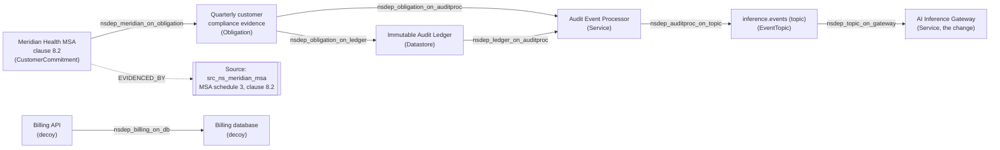
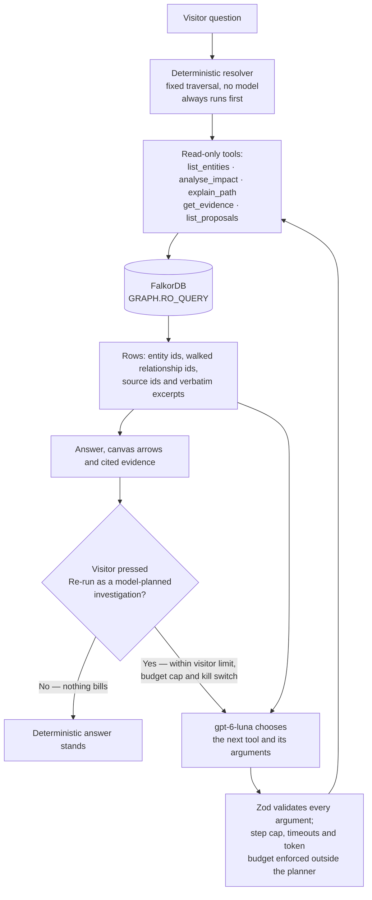

# NexusForge

Evidence-backed organizational intelligence on FalkorDB. NexusForge traces how
a change propagates through connected systems, shows the dependency path that
caused each consequence, and cites the source record behind every claim.

**Live demo: <https://nexusforge-ten.vercel.app>**

Graph structure and agent query flow are diagrammed in
[Graph map: nodes, relationships, and how the agent queries them](#graph-map-nodes-relationships-and-how-the-agent-queries-them).

Built for [Graph Hacks 2026](https://www.wemakedevs.org/hackathons/falkordb),
targeting Track 01 (Agents That Act on Connected Data) and Track 03
(Company Brain).

Everything described under "What works" is covered by tests that run against a
real FalkorDB instance. Nothing else is claimed.

## The problem

When something in an organization changes, the hard question is not what
happened. It is what is now exposed, why, and on what evidence.

A service catalogue tells you which services call the one that just failed.
It does not tell you that a customer contract four relationships away depends
on an audit trail that only exists because that service was publishing events.
That consequence is real, it is recorded in the data, and nobody looks for it,
because finding it means walking relationships rather than reading rows.

NexusForge answers four questions for any change:

1. What is affected?
2. Why is it affected, meaning the actual dependency path?
3. What evidence supports that, meaning a real source record with an excerpt?
4. What should be decided, and by whom?

## The Northstar Labs demonstration

> If Northstar Labs' AI inference gateway becomes unavailable, what is exposed,
> and what blocks a safe recovery?

Rooted at the gateway, the engine finds 10 distinct exposed entities across 12
dependency paths. Server-side analysis time is around 40 ms.

The finding that matters is four hops away and has no direct edge to the
gateway:

```
Meridian Health MSA clause 8.2
  -> quarterly compliance evidence
    -> audit event processor
      -> inference.events (topic)
        -> AI Inference Gateway
```

The gateway publishes to an event topic. An audit processor consumes it. The
audit ledger is built from that stream. Quarterly compliance evidence is
derived from the ledger. An enterprise contract requires that evidence. A
service dependency list would not surface this. A bounded graph traversal does.

The same scenario demonstrates three things the system refuses to do.

**It reports an ownership gap without filling it.** The on-call assignment
covering gateway failover names an engineer who left, and the roster records no
deputy. NexusForge surfaces the unresolved responsibility and does not invent a
qualified replacement, because no data supports one.

**It marks an uncertain constraint as uncertain.** The external failover plan
cites an architecture decision whose current status cannot be found. That edge
carries `MISSING` evidence and `supported: false`. The finding is one hop from
the gateway but is deliberately not labelled `OBSERVED`. The only action
proposed for it is closing the evidence gap, not routing around it.

**It excludes plausible non-dependencies.** Billing and model-registry services
are realistic neighbours in an AI company. Neither has a dependency route to
the gateway, and both are excluded. One decoy is an event topic structurally
identical to the real one, so exclusion cannot be a naming heuristic.

## Graph map: nodes, relationships, and how the agent queries them

Every id below is a real id in the seeded Northstar graph
([`src/domain/northstar/seed-data.ts`](src/domain/northstar/seed-data.ts)),
not an illustration. Edge labels are the actual `DEPENDS_ON` relationship ids
the traversal returns and the interface draws.



**Direction.** Arrows are stored as
`(dependent)-[:DEPENDS_ON]->(dependency)`, which is what the diagram draws,
because that is the fact recorded in the database. **Impact propagates in the
opposite direction:** the gateway is on the right, and losing it flows
leftwards to the contract clause. The traversal therefore walks these edges in
reverse, matching `(affected)-[:DEPENDS_ON*1..6]->(root)`.

Meridian sits four relationships from the gateway with no direct edge to it.
Two distinct routes reach it: the shorter one through
`nsdep_obligation_on_auditproc`, and a longer one through the audit ledger.
They share the processor, the topic and the gateway, so they are distinct
routes, not independent corroboration. `Billing API` is connected to its own
database but has no route to the gateway, so deterministic traversal excludes
it — exclusion is structural, never a name filter.

**What is in the graph**

| Category | In the application |
|---|---|
| Node labels | `:Entity`, `:Source`, `:AnalysisRun`, `:Finding`, `:ActionProposal`, `:AuditEvent` |
| `:Entity` `type` values | `Service`, `EventTopic`, `Datastore`, `Obligation`, `CustomerCommitment`, `FailoverPlan`, `Responsibility`, `OnCallAssignment`, `Person`, `ArchitectureDecision` |
| Dependency edge `kind` values | `calls_synchronously`, `produced_by`, `consumes`, `written_by`, `evidenced_from`, `requires_continuous_processing`, `contractually_requires`, `restores`, `constrained_by`, `executes`, `covers`, `assigned_to`, `reads_writes` |
| Relationship types | `DEPENDS_ON`, `EVIDENCED_BY`, `PROPOSED_IN`, `ABOUT_PROPOSAL`, `IN_RUN` |
| Evidence references | `src_ns_meridian_msa`, `src_ns_compliance_policy`, `src_ns_audit_design`, `src_ns_event_contract`, `src_ns_service_catalog`, `src_ns_runbook_failover`, `src_ns_oncall_roster`, `src_ns_incident_postmortem` |

Every dependency edge carries a `sourceId`. One is deliberately dangling:
`nsdep_plan_on_gateway` cites `src_ns_adr_014_current_status`, which does not
exist as a `:Source` node, so that edge resolves to `MISSING` evidence and its
finding is `supported: false`.

### How the agent queries the graph



**FalkorDB decides; the model only chooses what to ask.** The planner picks a
tool name and arguments. It cannot compose Cypher, because no tool accepts
Cypher. Every fact in an answer — which entities are exposed, the hops between
them, the claim class, the evidence status and the excerpts — comes back from
`GRAPH.RO_QUERY` against FalkorDB. Remove the database and there is no answer
to narrate: there is no in-memory fallback and no mocked FalkorDB anywhere in
the test suite. The tool summaries the planner reads carry the real entity ids,
so its next choice is constrained by what the graph actually returned.

**Model-planned versus deterministic.** These are separate paths and the
interface labels which one produced an answer:

| | Deterministic analysis | Model-planned investigation |
|---|---|---|
| Who picks the steps | Fixed code, or a scripted planner | `gpt-6-luna` |
| Where facts come from | FalkorDB | FalkorDB, identical read-only tools |
| Cost | None | Paid, rate limited per visitor |
| Status on the live demo | **Live**, and answers every question first | **Live** as an explicit opt-in, under visitor, budget and kill-switch limits |

The grounded deterministic answer is always computed first and is the
authoritative content. A model-planned run adds tool selection and narration
on top; it never replaces the grounded answer and never decides what is true.
The scripted planner is always labelled a scripted procedure, never reasoning.

**Scope limits, stated plainly.** Northstar Labs is entirely synthetic: no
real company, person, system, customer or contract is represented, and every
seeded node carries `synthetic: true`. The agent cannot execute external
actions — it has no write tool, no approve or reject tool, and no integration
that could act outside this application. Approval records a decision and
returns `executed: false`.

**Links**

- Live demo: <https://nexusforge-ten.vercel.app>
- [docs/GRAPH_MODEL.md](docs/GRAPH_MODEL.md): full schema, queries and rationale
- [docs/TRACK1_DEMO.md](docs/TRACK1_DEMO.md): the agent demonstration, step by step
- [docs/REQUIREMENTS.md](docs/REQUIREMENTS.md): hackathon requirements and how each is met
- Agent tools: [`src/lib/agent/tools.ts`](src/lib/agent/tools.ts) · planner: [`src/lib/agent/openai-planner.ts`](src/lib/agent/openai-planner.ts) · traversal: [`src/lib/graph/queries.ts`](src/lib/graph/queries.ts)

## The education demonstration

A synthetic school runs on the same engine with no code changes: 10 entities
across 13 paths from a resigning physics teacher, with an `SS1 Physics` class
correctly excluded despite the matching subject name. It shows the engine is
not sector-specific, and it doubles as a regression fixture.

Organizations are isolated in separate FalkorDB graphs. The browser sends an
allowlisted organization id and can never supply a graph name.

## Why FalkorDB

FalkorDB is the only datastore. There is no PostgreSQL, SQLite, separate Redis
store, or JSON persistence layer. Entities, sources, findings, proposals,
approvals and audit events are all nodes and edges.

The graph does the work that defines the product. Impact discovery is a
bounded, cycle-safe, multi-hop Cypher traversal that returns the exact
relationship ids it walked, which is what lets the interface draw and justify
every arrow. If FalkorDB is unavailable the system fails and says so. There is
no in-memory fallback pretending to be a graph database, and no mocked
FalkorDB anywhere in the test suite.

## What works

Verified by tests against a real FalkorDB instance.

**Graph reasoning**

- Bounded multi-hop dependency traversal with parameterized Cypher
- Decoy exclusion, verified structurally rather than by name filtering
- Provenance: every impacted entity resolves to a real `:Source` node
- Multiple routes to one entity count once, with every route inspectable
- Cycle safety: a deliberate cycle produces a stable, bounded result
- `GRAPH.RO_QUERY` write rejection, verified for `CREATE`, `SET`, `DELETE`, `MERGE`
- Graph namespace guard: only `nf_`-prefixed graphs are reachable
- Deterministic idempotent seeding, verified across repeated runs
- An independently formulated re-check query that cross-validates the count

**Evidence and claims**

- `OBSERVED` only for a single relationship backed by resolving evidence
- `DERIVED` for any conclusion reached by chaining relationships
- Evidence completeness tracked per edge as `COMPLETE`, `PARTIAL` or `MISSING`
- Unresolved references listed explicitly rather than hidden
- An enforced invariant that an unsupported finding can never be marked verified

**Durable analysis runs**

- `:AnalysisRun` and `:Finding` nodes with traversed relationship ids, path
  signatures and evidence references
- Findings survive a fresh application connection
- Concurrent runs never overwrite each other
- Retries are idempotent, and `persistAttempts` distinguishes a retry from a
  new run
- Run-scoped authorization using an opaque owner token, SHA-256 hashed at rest,
  enforced inside the mutating statement so there is no check-then-write race

**Actions and audit**

- `:ActionProposal` nodes generated by deterministic versioned rules
- `PROPOSED` to `APPROVED` or `REJECTED`, and nothing else
- Append-only `:AuditEvent` per transition, consistent with state, never
  duplicated on retry
- Reassignment proposals suppressed for findings whose evidence does not resolve

**Interface**

- Hop-column canvas with real directed edges keyed by actual `DEPENDS_ON`
  relationship ids
- Trace highlighting that dims unrelated nodes without removing them
- Inspector showing the Cypher template, bound parameters, hop accounting,
  alternative routes and verbatim source excerpts
- Organization isolation with state cleared on switch, and a request-generation
  guard that discards responses from a previously selected organization

**Input validation**

Traversal depth is validated by Zod before any Cypher is constructed.
Fractions, negatives, zero, out-of-range values, `NaN`, `Infinity` and all
string input are rejected. No string is ever coerced, which is what makes
injection through the depth bound structurally impossible rather than filtered.

## What is not implemented

Qualification and availability rules, replacement-candidate ranking,
contradiction detection, enterprise identity or role-based authorization, and
external action execution.

`REVIEWED`, `EXECUTED` and `VERIFIED` proposal states are deliberately absent.
The system performs no external action and cannot confirm one, so those states
would be a lie encoded in the schema.

Approval is not execution. An approved proposal records that a demo run owner
decided to proceed. Nothing has been executed, scheduled, communicated or
verified. Every transition returns `executed: false`.

## The agent layer

A constrained agent can investigate the graph and explain what it finds. Its
limits are structural rather than prompted:

- No tool accepts Cypher, so an agent cannot compose a query
- No approve or reject tool exists, so authority stays with the token holder
- No tool writes at all
- Every tool input is Zod-validated before execution, including depth
- Budgets, timeouts, a per-session step cap and a global call cap sit outside
  the planner, so swapping in a model cannot relax them
- The cumulative token and request budget is stored in FalkorDB and incremented
  atomically, so it holds across serverless instances rather than per process

Two planners exist. The scripted planner is deterministic and is labelled as a
scripted procedure, never as reasoning. The OpenAI planner uses the Responses
API and selects from the same constrained, read-only tool surface.

**A bounded public AI pilot is live.** Visitors can run a real model-planned
investigation against the deployed demo, with `gpt-6-luna` choosing which
read-only FalkorDB tools to call.

- **Deterministic investigation is always available**, and it is what every
  question answers with first. It needs no model and costs nothing.
- **The model path is an explicit per-question opt-in.** After a deterministic
  answer appears, Ask NexusForge shows a **"Re-run as a model-planned
  investigation"** control. Nothing bills unless a visitor presses it: the
  request carries `useModel: true` or no inference happens.
- **`/api/ask` is the model-planned surface. `/api/agent` remains scripted**
  and is not a model endpoint.
- **The model only selects tools.** It cannot compose Cypher, cannot write, and
  cannot approve. Every fact comes back from `GRAPH.RO_QUERY`.

Three independent controls bound the pilot, all enforced outside the planner:

| Control | Mechanism |
|---|---|
| Per-visitor limit | Five model-planned investigations per visitor per hour (`NF_AGENT_VISITOR_MAX_REQUESTS`). A limited visitor still gets the deterministic answer, not an error |
| Spending cap | A cumulative token and request ceiling held in FalkorDB and incremented atomically, so it holds across serverless instances. The deployment currently runs 150,000 tokens and 160 requests per rolling window, below the code defaults of 200,000 and 200 |
| Kill switch | `NF_AGENT_ENABLED` and `NF_AGENT_LLM` both default off, and a key alone cannot start billing. Clearing either flag ends all inference immediately without a redeploy of application code |

Exceeding the per-visitor limit or the spending cap degrades to the
deterministic answer rather than failing the request. The live capability can
be confirmed without spending anything: `GET /api/ask` reports
`modelAvailable` and the current budget snapshot.

**Human approval is still not external action execution.** A visitor approving
a proposal records a decision in the audit trail and nothing more. There is no
write tool, no integration, and no mechanism by which the agent or an approval
could act outside this application. Every transition returns
`executed: false`.

An earlier controlled paid test against `gpt-6-luna` recorded five model
requests, 4,711 tokens and 32.7 seconds, and the safety invariants held. No
cost-per-run figure is published, because no verified price for that model was
available to measure against.

## Setup

Requires Node.js 22 or later and a FalkorDB instance. The Cloud free tier is
sufficient.

```bash
npm install
cp .env.example .env.local   # then fill in your instance details
```

| Variable | Required | Notes |
|---|---|---|
| `FALKORDB_HOST` | yes | Instance hostname |
| `FALKORDB_PORT` | yes | Instance port |
| `FALKORDB_USERNAME` | yes | Defaults to `default` |
| `FALKORDB_PASSWORD` | yes | |
| `FALKORDB_TLS` | no | `false` on the Cloud free tier, which has no TLS |
| `FALKORDB_GRAPH` | no | Fallback graph. Per-organization graphs come from the server-side allowlist in `src/lib/org/registry.ts`. Must start with `nf_`. |
| `OPENAI_API_KEY` | no | Only for the model planner |
| `NF_AGENT_ENABLED` | no | `true` enables the agent. Default off. Set on the live demo. |
| `NF_AGENT_LLM` | no | `on` enables paid inference. Default off. Set on the live demo. Both flags are required, so a key alone cannot start billing. |
| `NF_AGENT_MODEL` | no | Planner model. Defaults to `gpt-6-luna`. |
| `NF_AGENT_MAX_TOKENS` | no | Cumulative token ceiling per window. Code default 200,000. |
| `NF_AGENT_MAX_REQUESTS` | no | Cumulative model-request ceiling per window. Code default 200. |
| `NF_AGENT_VISITOR_MAX_REQUESTS` | no | Per-visitor model-planned investigations per window. Code default 5. |

`.env.local` is gitignored and must never be committed.

```bash
npm run seed                            # seed the education graph
npx tsx scripts/seed-org.ts northstar   # seed Northstar
npm run graphs:list                     # read-only inventory of graphs
npm run impact                          # run an analysis, print the result
npm test                                # integration tests, real database
npm run typecheck
npm run build
npm run dev                             # http://localhost:3000
```

Diagnostics:

```bash
npx tsx scripts/probe.ts                 # feasibility probe, self-cleaning
npx tsx scripts/diagnose-connection.ts   # network diagnosis, masks hostnames
npx tsx scripts/audit-contamination.ts   # read-only cross-organization check
```

On Windows, Turbopack dev cannot create the junction for the `falkordb`
external package without symlink permission, so local verification uses
`npm run build` followed by `npm start`. Vercel builds on Linux and is
unaffected.

## Graph model

Full detail in [docs/GRAPH_MODEL.md](docs/GRAPH_MODEL.md).

`:Entity` is any organizational thing. A single label with a `type` property
keeps the engine sector-agnostic: swapping in a logistics or healthcare pack
requires new seed data, not new queries.

`:Source` is an evidence record with a `reference` and a verbatim `excerpt`.
This is deliberately not a document management subsystem.

`(dependent)-[:DEPENDS_ON]->(dependency)` is the one direction rule everything
else follows. Edges point from the thing that depends to the thing it depends
on, so impact traversal walks them in reverse. Arrowheads in the interface show
the stored direction, because that is the verifiable fact, and the legend
states that impact propagates the other way.

`(:Entity)-[:EVIDENCED_BY]->(:Source)` carries provenance.

`edgeHops` counts graph relationships. `entityHops` counts meaningful
organizational transitions, ignoring intermediary nodes that only reify a
relationship. They are reported separately and never conflated.

### The central traversal

```cypher
MATCH p = (affected:Entity)-[:DEPENDS_ON*1..6]->(root:Entity {id: $rootId})
WHERE affected.id <> $rootId
  AND ALL(x IN nodes(p) WHERE size([y IN nodes(p) WHERE y.id = x.id]) = 1)
RETURN affected.id                          AS entityId,
       [n IN nodes(p) | n.id]               AS pathIds,
       [r IN relationships(p) | r.id]       AS pathRelIds,
       [r IN relationships(p) | r.sourceId] AS pathSourceIds,
       length(p)                            AS edgeHops
ORDER BY entityId, edgeHops, pathIds
```

`$rootId` is a bound parameter. The depth bound cannot be, because openCypher
rejects a parameter inside `*1..n`, so it is validated as an integer in 1 to 8
and interpolated. Nothing else is interpolated, and no caller can supply raw
Cypher.

The `ALL(...)` predicate enforces node distinctness. Relationship uniqueness
alone still admits trails that revisit a node, which is exactly what a
governance cycle produces.

The query returns one row per route. Collapsing routes to distinct entities
happens in application code, so alternative evidence paths stay inspectable.

### Independent re-check

A differently formulated query cross-checks the distinct count. If the two
disagree, one of them is wrong, and the test asserts they agree rather than
trusting either alone.

```cypher
MATCH (affected:Entity)-[:DEPENDS_ON*1..6]->(root:Entity {id: $rootId})
WHERE affected.id <> $rootId
RETURN count(DISTINCT affected.id) AS distinctCount
```

### Authorized state transition

Ownership, run membership, expected prior state, the state change and the audit
event are one statement, so they cannot disagree.

```cypher
MATCH (run:AnalysisRun {analysisRunId: $runId, ownerTokenHash: $ownerTokenHash})
MATCH (p:ActionProposal {proposalId: $proposalId})-[:PROPOSED_IN]->(run)
WHERE p.state = $fromState
SET p.state = $toState, p.decidedAt = $now, p.decidedBy = $actor
CREATE (a:AuditEvent { auditEventId: $auditEventId, fromState: $fromState,
                       toState: $toState, at: $now, actor: $actor })
MERGE (a)-[:ABOUT_PROPOSAL]->(p)
MERGE (a)-[:IN_RUN]->(run)
RETURN a.auditEventId AS auditEventId, p.state AS toState
```

If the first match binds nothing, every later clause is skipped. A wrong token
and a repeated transition fail identically and write nothing.

## Organization isolation

One FalkorDB graph per organization, resolved only through a server-side
allowlist in `src/lib/org/registry.ts`. The browser sends an organization id.
An unknown id fails closed with a 400 rather than falling back to a default.

Isolation is enforced by the database boundary rather than by a `WHERE` clause
somebody might forget. A run id from one organization does not exist in
another's graph.

This is demonstration isolation, not enterprise multitenancy. There is no
per-user identity, and an operator with instance credentials can read every
graph.

## Synthetic data

All demonstration data is synthetic. No real company, school, person, system,
customer, contract or examination is represented. Every seeded node carries
`synthetic: true`.

## Known limitations

**Mobile graph access.** The graph was originally hidden below 768px. The
canvas now renders at every viewport, with a Findings and Graph toggle below
the `lg` breakpoint, narrower columns, tap targets and Trace by tap. This makes
the graph reachable and usable on a phone. It is not a purpose-built mobile
graph experience, and a graph with many entities per hop still needs horizontal
panning. The fix is verified by build and code review, not on a device.

**Intermittent DNS failures** resolving the FalkorDB Cloud hostname. A
28-sample diagnosis measured a 7.1% failure rate entirely at the DNS layer,
with zero TCP and zero database failures once the name resolved. Mitigated with
a 31-second retry budget calibrated to the measured recovery time, but not
eliminated: the test suite still fails intermittently for this reason.

**Cold connect latency** averages about 5 seconds to the free-tier instance,
with a measured maximum of 19 seconds, so connection reuse is essential.

**Seeding is recoverable, not atomic.** FalkorDB executes each query
atomically, but the seed spans several statements with no cross-statement
transaction. Every statement is `MERGE`-keyed so re-running repairs a partial
seed, and a `SeedMarker` written last makes partial state detectable.

**The free tier has no TLS**, so credentials cross the network unencrypted.
Acceptable for synthetic demonstration data only.

**Parallel edges under-report routes.** Two `DEPENDS_ON` edges between the same
pair collapse to one stored path, because path signatures key on node ids.
Entity counts, claims and evidence stay correct. This is tested and documented
rather than repaired, because the seeds provably contain none.

**An owner token is not identity.** It proves only that the caller created the
run. It is not authentication, and not authority to approve a business action.

### Independent audit

Two independent audits were run against an earlier commit. Fixed since:

- Agent read tools could seed education data into the Northstar graph, because
  they called `ensureSeeded` with no domain pack and the education default
  applied. Seeding is removed from the tool surface, the pack argument is now
  required so omitting it is a compile error, and the agent is disabled by
  default.
- While verifying that fix, a probe request against the still-vulnerable
  deployment triggered the defect and contaminated the Northstar graph. It was
  repaired by surgical removal under a read-only inventory, preserving the
  analysis runs, findings and proposals. Both graphs are now clean.
- "Independent routes" was an unsupported claim. The two Meridian routes share
  the obligation, the audit processor, the topic and the gateway. The wording
  is now "distinct routes", with an explicit note that they may share
  intermediates.
- Reassignment was proposed for findings whose evidence does not resolve. Those
  now receive only the evidence-gap proposal.
- Suggested questions that did not resolve to their advertised intent and
  entity are hidden rather than shipped broken.
- The scope answer named a hardcoded organization. It now reports the loaded
  one.
- Questions naming entities the dataset does not contain were silently answered
  about a different root. They are now refused with an explanation.
- Delayed responses could render under a newly selected organization. A
  request-generation guard discards them.
- Closing the Inspector on mobile cleared the highlighted path. Inspector
  visibility is now separate from the traced selection.

### Manual mobile checklist

- [ ] Graph tab renders the canvas with visible directed edges
- [ ] Tapping a node opens the Inspector and dims unrelated nodes
- [ ] Closing the Inspector preserves the traced path
- [ ] Edges stay attached to nodes while panning horizontally
- [ ] Alternative routes are selectable in the Inspector
- [ ] Evidence excerpts are readable without horizontal page scroll
- [ ] Approve and reject controls are tappable
- [ ] Switching organization clears the previous investigation

## AI assistance disclosure

Required by the hackathon rules.

This project was built with Claude Code (Anthropic) acting as implementing
engineer, under the direction of the project owner, who set the architecture,
constraints and acceptance criteria, and who reviewed the work. AI assistance
covered scaffolding, Cypher and TypeScript implementation, test authoring and
documentation.

Two independent audit passes by a separate reviewer identified the defects
listed above, which were then fixed and regression-tested.

All results reported in this document come from execution against a real
FalkorDB instance. Where something is unverified, it says so.

## Documentation

- [docs/GRAPH_MODEL.md](docs/GRAPH_MODEL.md): schema, queries, design rationale
- [docs/REQUIREMENTS.md](docs/REQUIREMENTS.md): verified hackathon requirements
- [docs/LOG.md](docs/LOG.md): engineering log, results, mistakes and fixes
